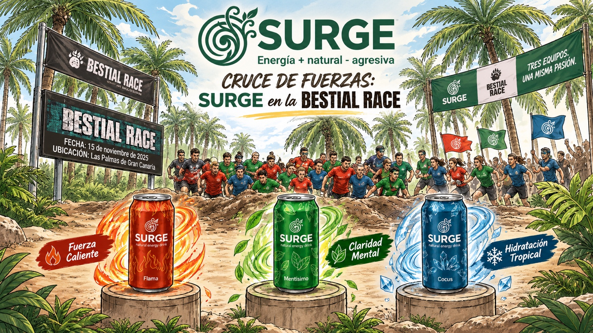
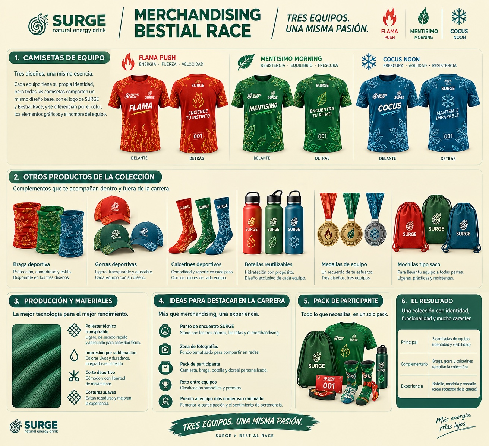

# BSURGE × BESTIAL RACE — BRIEF COMPLETO DE LA LANDING
1. Qué queremos construir
Crear una landing page de campaña para la colaboración de SURGE con la Bestial Race. No debe parecer una web genérica de una carrera ni una página independiente que no tenga relación con la marca. Debe sentirse como una sección especial de la web oficial de SURGE, respetando el diseño, la navegación, los componentes, las tipografías y el estilo visual que ya tenga el proyecto.

La página debe contar una historia: SURGE se une a la Bestial Race para convertir la carrera en una experiencia de marca y comunidad. La campaña se organiza alrededor de tres equipos inspirados en los sabores y códigos visuales de SURGE. Los participantes eligen equipo, se identifican con sus colores y llevan su camiseta. Los influencers ayudan a dar visibilidad a la acción y la comunidad puede participar en los retos y activaciones planteadas.

La página debe ser atractiva, moderna, visual y fácil de recorrer. Debe transmitir energía, deporte, naturaleza, superación, diversión y ambiente de evento. Tiene que funcionar bien tanto en ordenador como en móvil.
2. Contexto de marca: SURGE
SURGE es una marca ficticia de bebida energética natural desarrollada para el proyecto de marketing del equipo. El producto combina té y guaraná y se plantea sin azúcar añadido. La marca se relaciona con energía, actividad física, deporte, bienestar y un estilo de vida activo.

Los tres sabores/identidades visuales trabajados son:
- Flama: rojo/naranja, fuego y fuerza.
- Mentisimo: verde, hojas y frescura.
- Cocus: azul, hielo y frescura tropical.
La identidad de SURGE debe conservar su equilibrio entre lo natural y lo energético: recursos vegetales, ilustraciones dibujadas, colores potentes, una estética fresca y deportiva. No convertir la marca en una bebida artificial o en una marca extrema de competición.

La web principal de SURGE ya tiene o tendrá otras páginas relacionadas con el producto. Esta landing debe enlazarse con ellas cuando existan rutas reales: inicio, producto/sabores, packs, sobre nosotros u otras secciones existentes. No inventar URLs. Reutilizar la navegación común del proyecto.
3. Estilo visual y dirección de arte
La landing debe seguir la misma línea gráfica que las páginas anteriores de SURGE. Antes de programar, revisar el diseño real del repositorio y utilizar sus componentes, fuentes, espaciados, botones, cabecera, footer y sistema de colores.

Dirección visual deseada:
- Estética deportiva, tropical, natural y enérgica.
- Inspiración visual en las latas de SURGE, las ilustraciones botánicas, las llamas y los cristales de hielo.
- Fotografías/ilustraciones grandes y protagonistas, no una página llena de cajas pequeñas.
- Fondos claros o crema combinados con bloques de verde oscuro y acentos de los tres equipos.
- Secciones diferenciadas con jerarquía visual clara, buen espacio en blanco y tipografía contundente.
- Animaciones sutiles solo si el proyecto ya las utiliza o si aportan valor; evitar efectos excesivos.
- La página debe sentirse cuidada y profesional, como una campaña real de marca deportiva.
Paleta de referencia SURGE:
- Verde oscuro: #2D6A4F
- Verde claro: #B7E4C7
- Amarillo: #F4D35E
- Crema: #FEFAE0
- Marrón: #3D2B1F
Colores de equipo:
- Team Flama: rojo y naranja.
- Team Mentisimo: verde.
- Team Cocus: azul/azul petróleo.
El diseño debe mantener una identidad común SURGE y diferenciar cada equipo mediante su color, símbolo y camiseta.
4. Imágenes oficiales adjuntas
Hay dos imágenes proporcionadas por el equipo. Deben utilizarse exactamente para los fines descritos; no sustituirlas por imágenes generadas ni por imágenes de stock.
A. Portada principal de la carrera
Archivo: assets/bestial-race/portada-bestial-race.jpeg

Esta es la portada principal de la colaboración SURGE × Bestial Race. Debe aparecer en el Hero al principio de la landing y ser el elemento visual protagonista. Mantener la imagen completa siempre que sea posible, sin cortar el logotipo, el texto principal, los corredores ni las tres latas.

Texto alternativo:
Portada ilustrada de SURGE en la Bestial Race, con corredores, palmeras y las tres latas de los equipos Flama, Mentisimo y Cocus.
B. Imagen oficial del merchandising
Archivo: assets/bestial-race/merchandising-bestial-race.jpeg

Esta imagen es la lámina de merchandising desarrollada por el equipo. Debe aparecer en una sección específica de merchandising, después de presentar los tres equipos. Mostrarla completa y con tamaño suficiente para leer y apreciar las camisetas y los productos.

Texto alternativo:
Lámina de merchandising SURGE para la Bestial Race con camisetas de los tres equipos, bragas deportivas, gorras, calcetines, botellas, medallas, mochilas y pack de participante.

No usar estas imágenes como fondo con recorte agresivo. En móvil, permitir que se adapten o se puedan ampliar/abrir para ver los detalles.
5. Estructura y experiencia de la página
Crear una landing larga, con navegación clara y secciones en este orden aproximado. Ajustar el orden si la arquitectura actual del sitio lo aconseja, sin eliminar contenido importante.
Sección 1 — Hero / portada
- Utilizar portada-bestial-race.jpeg como imagen protagonista.
- Presentar el título: SURGE llega a la Bestial Race.
- Mensaje principal: Tres equipos. Tres identidades. Una misma pasión.
- Texto breve: SURGE se une a la Bestial Race para crear una experiencia deportiva en la que los participantes podrán elegir equipo, vestir sus colores y compartir el desafío.
- CTA principal: Descubre los equipos, que desplace a la sección de equipos.
- CTA secundario opcional: Conoce el merchandising, que desplace a esa sección.
- No incluir botón de inscripción activo hasta disponer de un enlace oficial.
Sección 2 — La colaboración / historia
Contar brevemente por qué SURGE participa en la Bestial Race:
- La carrera es una oportunidad para acercar la marca a personas activas y amantes del deporte.
- La propuesta busca crear una experiencia de comunidad, no limitarse a colocar un logo en un evento.
- Los tres equipos conectan los sabores e identidades visuales de SURGE con la participación en la carrera.
- Los influencers y la comunidad amplifican la experiencia en redes sociales.
- La campaña debe generar contenido, alcance y diferenciación de marca.
Tono cercano, motivador y dinámico. No inventar una historia real de patrocinio, acuerdos oficiales o resultados ya obtenidos. Presentarlo como la propuesta/campaña de SURGE.
Sección 3 — Los tres equipos
Presentar tres tarjetas o bloques potentes, visualmente equilibrados. En cada equipo mostrar color, símbolo, concepto, influencers y camiseta.

TEAM FLAMA
- Color: rojo/naranja.
- Símbolo: llamas.
- Conceptos de campaña: energía, fuerza y velocidad.
- Influencers asignados en el Canva: Armide Soliveres Acuyo, Anixua Perera Dávila y Lola Ortiz.
- Camiseta: roja, con llamas, identidad SURGE y nombre del equipo.
- Frase de camiseta propuesta: «Enciende tu instinto».
TEAM MENTISIMO
- Color: verde.
- Símbolo: hoja/menta.
- Conceptos de campaña: resistencia, equilibrio y frescura.
- Influencers asignados en el Canva: Iraida Martín, Pablo Vera y Gazz.
- Camiseta: verde, con hojas, identidad SURGE y nombre del equipo.
- Frase de camiseta propuesta: «Encuentra tu ritmo».
TEAM COCUS
- Color: azul.
- Símbolo: hielo/cristal.
- Conceptos de campaña: frescura, agilidad y resistencia.
- Influencers asignados en el Canva: Zulay Marrero, El Morito Canario y Tania Pyetku.
- Camiseta: azul, con ilustraciones de hielo, identidad SURGE y nombre del equipo.
- Frase de camiseta propuesta: «Mantente imparable».
Los nombres oficiales son Team Flama, Team Mentisimo y Team Cocus. Los nombres de los sabores que aparecen en los envases (Flama Push, Mentisimo Morning y Cocus Noon) no deben sustituir a los nombres oficiales de los equipos.

Los conceptos de equipo y frases son recursos creativos de campaña; no hacer afirmaciones médicas ni promesas de rendimiento.
Sección 4 — Cómo funciona la dinámica
Explicar con pasos sencillos:
1. Descubre los tres equipos.
2. Elige el equipo con el que te identificas.
3. Lleva la camiseta de sus colores.
4. Participa en la experiencia y los retos de SURGE alrededor de la carrera.
5. Comparte tus momentos y anima a tu equipo.
La idea es que los participantes elijan equipo y lleven su camiseta correspondiente. No inventar un sistema técnico de registro o selección si aún no está definido. Si se necesita un botón, utilizar un CTA informativo o dejarlo pendiente hasta que el equipo confirme el mecanismo.
Sección 5 — Merchandising oficial
- Utilizar merchandising-bestial-race.jpeg como imagen principal de esta sección.
- Explicar que la camiseta de cada equipo es la pieza central y que cada participante llevará la camiseta del equipo que elija.
- La lámina muestra tres camisetas con diseño común de colección y variaciones de color, ilustración y nombre.
- Mostrar los complementos que aparecen en la lámina: braga deportiva, gorra, calcetines, botella reutilizable, medalla y mochila tipo saco.
- Presentar el pack de participante como propuesta visual.
- Explicar que los productos complementarios y el pack son propuestas sujetas a presupuesto y aprobación, no productos confirmados para venta/entrega.
Materiales y producción que aparecen como propuesta en la lámina:
- Poliéster técnico transpirable.
- Impresión por sublimación.
- Corte deportivo.
- Costuras suaves.
No afirmar que los productos ya están fabricados ni garantizar especificaciones que no estén confirmadas.
Sección 6 — Influencers y comunidad
- Mostrar la distribución de influencers por equipos.
- Comunicar que la idea es participar con influencers y suscriptores/seguidores; el material del proyecto plantea cubrir la entrada de los suscriptores participantes.
- Incluir también al equipo de SURGE dentro de la experiencia y los equipos, tal como aparece en el planteamiento.
- No añadir biografías, cifras de seguidores, enlaces a perfiles ni datos personales no proporcionados.
- Si no existen enlaces verificados a redes sociales, mostrar nombres sin enlaces.
Sección 7 — Activaciones en la Bestial Race
Presentar como ideas de campaña:
- Punto de encuentro SURGE con los tres colores, las latas y el merchandising.
- Zona de fotografías para compartir contenido en redes.
- Juego o reto para conseguir merchandising.
- Reto simbólico entre los tres equipos.
- Participación de influencers y suscriptores.
- Gymkana after como actividad posterior planteada.
La propuesta busca conseguir alcance y repercusión en redes sociales, diferenciar la marca y crear una experiencia participativa. No inventar reglas, premios concretos, horarios ni detalles logísticos.
Sección 8 — Calendario de campaña
Respetar el cronograma del Canva:

MAYO — PRE-LANZAMIENTO
- Generar expectación.
- Presentar SURGE y sus productos.
- Contenido de lifestyle, nutrición/hábitos y retos saludables.
- Presentar a los influencers y los tres equipos.
- Activar conversación y comunidad.
JUNIO — CARRERA
- 1–15 de junio: presentación de equipos y entrenamientos.
- 16–22 de junio: cobertura y retos durante la carrera.
- 23–30 de junio: resumen y agradecimiento.
La carrera se ha confirmado para el mes de junio en esta planificación, pero el día exacto, horario y detalles logísticos están pendientes. No presentar el rango de campaña como fecha oficial del evento.

JULIO — POST-CARRERA
- 1–13 de julio: historias y experiencias.
- 14–20 de julio: retos para la comunidad con #ViveSurge.
- 21–27 de julio: cierre de campaña, impacto social y agradecimiento.
Hashtags de campaña: #ViveSurge, #SurgeLifestyle y #Healthy.

Mostrar el calendario de forma visual, por ejemplo con una línea temporal o tres bloques de meses, manteniendo la legibilidad en móvil.
Sección 9 — Cierre / CTA final
Mensaje:
Tres equipos. Una misma pasión. Vive la experiencia SURGE.

Texto de cierre que anime a elegir equipo, seguir la campaña y compartir la experiencia. Incluir los hashtags #ViveSurge, #SurgeLifestyle y #Healthy.
6. Información de evento y límites
- Evento: Bestial Race.
- Ubicación mencionada en el material visual del proyecto: Las Palmas de Gran Canaria.
- Mes de la carrera en el calendario acordado: junio.
- Día exacto: pendiente de confirmación.
- Horarios, recorrido, precio, inscripción, premios, normas y condiciones: no facilitados/pendientes.
- No reutilizar como fecha actual el «15 de noviembre de 2025» que aparece en una ilustración anterior; esa fecha no corresponde a la planificación confirmada para esta landing.
- No inventar un enlace de inscripción ni enlaces externos.
- No presentar acuerdos de patrocinio, premios o actividades como confirmados si solo son propuestas.
7. Navegación e integración con la web SURGE
La landing debe integrarse en la web existente:
- Mantener la cabecera, menú, footer, logo, tipografía y estilos del sitio.
- Añadir el acceso a Bestial Race en la navegación o en el lugar que tenga sentido según la arquitectura actual.
- Incluir enlaces internos a las páginas reales de SURGE relacionadas con productos, sabores, packs y sobre nosotros, si esas páginas/rutas ya existen.
- Incluir una forma clara de volver a la página principal.
- No inventar rutas: revisar las rutas reales del proyecto antes de enlazar.
- No romper la navegación ni los enlaces existentes.
- Mantener el diseño coherente con las páginas previas, como si Bestial Race fuera una campaña oficial dentro de la web de SURGE.
8. Requisitos técnicos
Antes de desarrollar:
1. Leer AGENTS.md y todas las instrucciones aplicables.
2. Revisar core.md, home.md, diseño.md, las páginas existentes y la estructura del repositorio.
3. Determinar cómo se utilizan los archivos de configuracion-agente/Estructura/ y cómo se implementan las páginas reales.
4. Seguir el framework, componentes, estilos, convenciones y sistema de rutas que ya use el proyecto.
5. No asumir que un archivo Markdown por sí solo se renderiza como página web.
Implementación:
- Crear/actualizar la landing real en el lugar correcto del proyecto.
- Mantener el contenido de este brief como referencia.
- Usar las dos imágenes locales exactas.
- Añadir alt text.
- Optimizar tamaño, carga y responsive.
- Usar navegación por anclas para los CTA internos.
- Mantener contraste, legibilidad y accesibilidad básica.
- Evitar dependencias nuevas si no son necesarias.
- No cambiar otras páginas ni estilos globales salvo que sea imprescindible.
Antes de terminar:
- Comprobar las dos imágenes en escritorio y móvil.
- Comprobar enlaces internos y navegación.
- Comprobar que la portada no queda recortada de forma que pierda información.
- Comprobar que la lámina de merchandising se puede leer.
- Comprobar que no se rompen otras secciones.
- Resumir qué archivos se han creado/modificado y qué datos siguen pendientes.
- Dejar todo preparado para revisión. No hacer commit, push ni publicar sin autorización.
9. SEO
- Title: SURGE en la Bestial Race | Elige tu equipo
- Meta description: Descubre la experiencia SURGE en la Bestial Race: Team Flama, Team Mentisimo y Team Cocus. Tres equipos, merchandising y una misma pasión por el deporte.
- H1: SURGE llega a la Bestial Race
- Usar encabezados claros para equipos, merchandising, influencers, calendario y participación.
- Añadir texto alternativo descriptivo a las imágenes.
- No forzar repetición de palabras clave ni sacrificar la naturalidad del contenido.estial Race

## Contexto

Bestial Race es la serie de carreras de obstáculos (OCR) de Canarias, organizada por Bestial Events desde 2014. Tiene pruebas en varias islas y una final en Gran Canaria. Web oficial: `https://ocrbestial.com`. Instagram: `https://www.instagram.com/bestial_race/`.

SURGE es marca canaria y comparte público con la carrera: gente activa, de 24 a 40 años, que entrena y vive el deporte sin buscar el golpe de las energéticas convencionales.

**Dato pendiente:** la edición de 2027 en la que participa SURGE se celebra en **junio o julio de 2027**. La fecha exacta no está publicada. La página debe decir `Junio–julio de 2027 · fecha por confirmar` y no inventar día, hora ni municipio.

## Objetivo de la página

- Explicar qué es la Bestial Race y por qué SURGE está ahí.
- Dar una fecha y un CTA claro para seguir la información oficial.
- Captar contactos para el equipo de carrera o para la lista de avisos.
- Reforzar el posicionamiento: energía natural para gente que se mueve.

## Ruta

`/bestial-race`

## Estructura

1. Hero.
2. Qué es la Bestial Race.
3. SURGE en la carrera.
4. Cómo prepararte.
5. Fecha y avisos.
6. CTA final.
7. Footer global.

## Copy

### Hero

- Kicker: `SURGE × BESTIAL RACE · CANARIAS`.
- H1: `La energía también se corre`.
- Entradilla: `Bestial Race es barro, obstáculos y gente que no se queda en el sofá. SURGE estará en la edición de 2027 con energía natural para antes, durante y después.`
- CTA primario: `Quiero que me avisen` → formulario de contacto con asunto `Bestial Race`.
- CTA secundario: `Ver la Bestial Race` → `https://ocrbestial.com` en pestaña nueva.
- Dato destacado: `Junio–julio 2027 · fecha por confirmar`.

### Qué es la Bestial Race

- H2: `Una carrera de obstáculos, no una carrera de fondo`.
- Texto: `La Bestial Race es la serie OCR de referencia en Canarias. Combina distancia, barro, obstáculos y pruebas de fuerza en un recorrido diseñado para poner a prueba el cuerpo y la cabeza. Hay modalidades competitivas y otras pensadas para disfrutar.`
- Chips: `OCR`, `Canarias`, `Desde 2014`, `Varias islas`.
- Enlace: `Conocer las modalidades` → `https://ocrbestial.com/bestial-race-series/`.

### SURGE en la carrera

- H2: `Energía que sube desde dentro`.
- Texto: `No vamos a prometerte que el barro pesa menos. Vamos a estar allí con bebidas de ingredientes reales, sin azúcar añadido en Flama y Cocus, y con cafeína de té y guaraná. Para el calentamiento, la carrera y la vuelta a casa.`
- Tres bloques:
  - `Antes · Flama` — `Té negro, mango, jengibre y pimienta. 80 mg de cafeína.`
  - `Durante · Mentisimo` — `Té verde, menta y lima. 65 mg. Fría o caliente.`
  - `Después · Cocus` — `Agua de coco, lima y jengibre. 50 mg. Solo fría.`
- Aviso obligatorio: `Contenido elevado de cafeína. No recomendado para niños ni para mujeres embarazadas o en período de lactancia.`

### Cómo prepararte

- H2: `Llega con tiempo. Llega con ganas`.
- Lista breve:
  - `Calzado con agarre y ropa que puedas manchar.`
  - `Agua y una lata para después.`
  - `Cambio de ropa y bolsa para el barro.`
  - `Respeta tu ritmo: la carrera es larga y el cuerpo manda.`
- Enlace: `Consejos oficiales de la carrera` → `https://ocrbestial.com/documentacion/`.

### Fecha y avisos

- H2: `Junio–julio de 2027`.
- Texto: `La organización todavía no ha publicado la fecha exacta. Déjanos tu email y te avisamos cuando se abran inscripciones, cuando salga el recorrido y cuando anunciemos nuestra presencia.`
- Formulario corto: email + checkbox de privacidad + botón `Avísame`.
- Modo demostración mientras no haya servicio de envío: no guardar datos, mostrar confirmación en pantalla.
- Enlace secundario: `Seguir a Bestial Race en Instagram` → `https://www.instagram.com/bestial_race/`.

### CTA final

- `Monta tu pack para el día de la carrera` → abre el modal de packs.
- `Ver dónde comprar` → `/donde-comprar`.

## Requisitos técnicos

- La página reutiliza header y footer globales.
- Los enlaces externos abren en pestaña nueva con `rel="noopener noreferrer"`.
- No cargar el feed de Instagram ni scripts de la carrera: solo enlaces.
- SEO: título `Bestial Race 2027 · SURGE — Energy from the earth`; meta description con OCR, Canarias y junio–julio de 2027.
- Open Graph con `inicial.webp`.
- Sin claims de patrocinio oficial hasta que exista acuerdo firmado. Usar `SURGE × Bestial Race` y `colaboración`, no `patrocinador oficial`.

## Prohibido

- Inventar fecha, municipio, recorrido, número de obstáculos o precios de inscripción.
- Decir que SURGE es patrocinador oficial si no está firmado.
- Prometer resultados deportivos o beneficios de salud.
- Usar fotos de la carrera sin permiso.
- Usar «hecho en Canarias» o «producto canario».
## Imágenes oficiales de la campaña

### Portada de Bestial Race

### Merchandising de los tres equipos

